<div align="center">


# EduNest

**Học có lộ trình, có giáo viên đồng hành.**

Nền tảng học trực tuyến cho học sinh THPT. Mỗi khóa học có video, bài đọc và bài kiểm tra chấm ngay. Học viên còn được thi thử, luyện tập, chơi mini game ôn bài và nhận chứng nhận có mã xác minh công khai.


</div>

---

## Điểm nổi bật

|                               |                                                                                                                                                            |
| ----------------------------- | ---------------------------------------------------------------------------------------------------------------------------------------------------------- |
| 🎓 **Học theo lộ trình**      | Khóa học chia chương, bài. Có video, bài đọc, PDF và bài kiểm tra. Tiến độ được lưu để học tiếp đúng chỗ trên mọi thiết bị.                                |
| ✅ **Chấm điểm tức thì**      | Năm dạng câu hỏi: một đáp án, nhiều đáp án, đúng/sai, điền từ, sắp xếp. Xem lời giải sau khi đạt. Học xong nhận chứng nhận có mã tra cứu.                  |
| 🏆 **Thi thử trực tuyến**     | Kỳ thi có giờ mở và giờ đóng. Hệ thống giám sát rời tab, xếp hạng và vinh danh người đứng đầu.                                                             |
| 🎮 **Ôn tập như chơi**        | Thẻ ghi nhớ lặp lại ngắt quãng và hai mini game Bắn bong bóng, Mưa chữ. Học viên tích XP, lên cấp, giữ chuỗi ngày học, nhận huy hiệu và lên bảng xếp hạng. |
| 🤖 **Trợ lý AI**              | Hỏi đáp ngay trong bài học. Giáo viên dùng AI để soạn nhanh câu hỏi (Google Gemini).                                                                       |
| 💳 **Thanh toán đa kênh**     | Giỏ hàng, mã giảm giá, gói combo, mã kích hoạt. Thanh toán qua MoMo hoặc chuyển khoản VietQR, đối soát tự động và cấp quyền học ngay.                      |
| 🔔 **Kết nối thời gian thực** | Thông báo tức thì, email và thông báo đẩy trên trình duyệt. Có chat hỗ trợ, cộng đồng và buổi học trực tiếp kèm bản ghi.                                   |
| 👨‍👩‍👧 **Phụ huynh đồng hành**    | Phụ huynh xem tiến độ, kết quả kiểm tra và nhận báo cáo tuần của con.                                                                                      |
| 🔐 **An toàn tài khoản**      | Xác thực 2 lớp cho nhân sự, giới hạn số thiết bị, cảnh báo đăng nhập lạ, watermark nội dung và nhật ký kiểm toán.                                          |

## Giao diện

### Khách tham quan

<table>
  <tr>
    <td width="50%">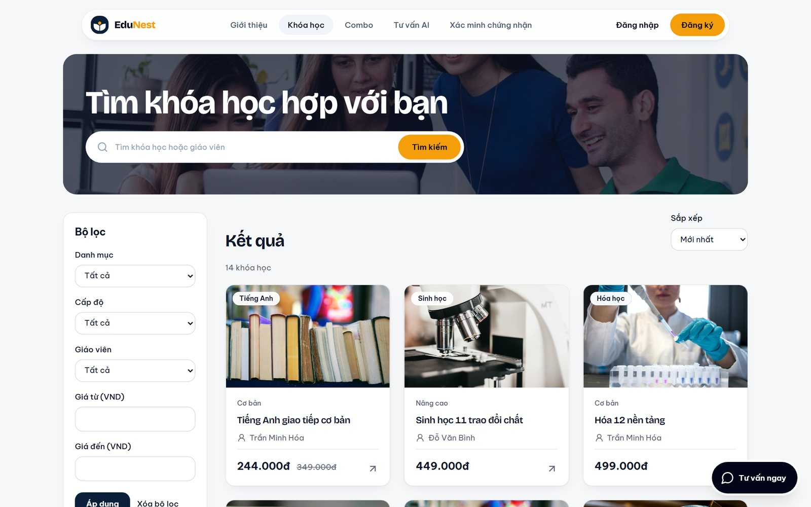<br/><sub><b>Danh mục khóa học</b>: tìm kiếm, lọc theo môn, cấp độ, giáo viên, giá</sub></td>
    <td width="50%">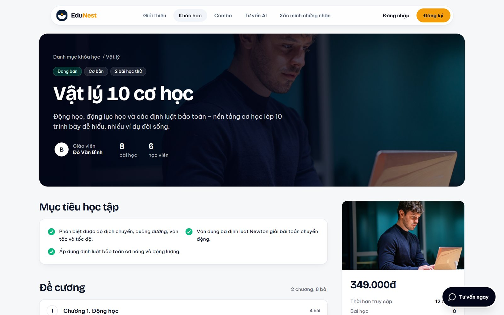<br/><sub><b>Trang khóa học</b>: mục tiêu, đề cương, giáo viên, đánh giá của học viên</sub></td>
  </tr>
</table>

### Học viên

<table>
  <tr>
    <td width="50%">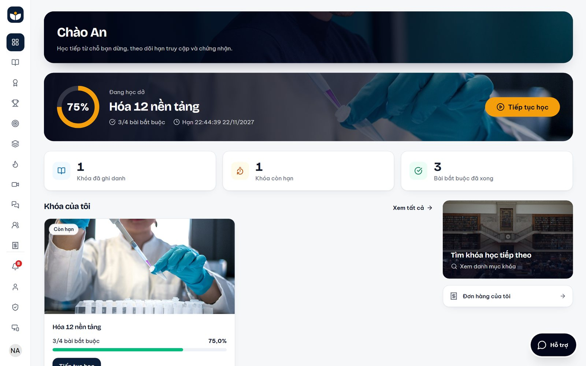<br/><sub><b>Trang của tôi</b>: học tiếp khóa đang dở, việc cần làm hôm nay</sub></td>
    <td width="50%">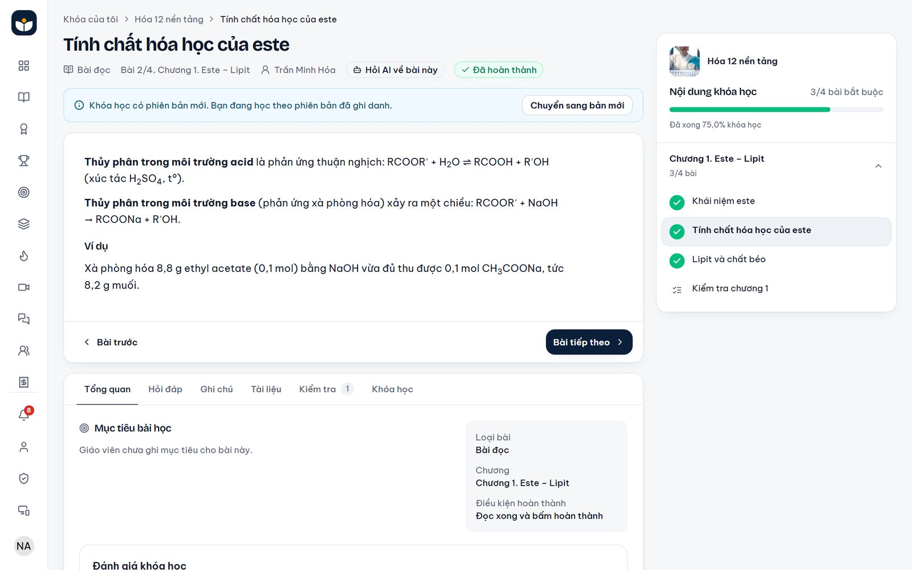<br/><sub><b>Trình học</b>: nội dung bài, mục lục, tiến độ, hỏi AI, hỏi đáp, ghi chú</sub></td>
  </tr>
  <tr>
    <td>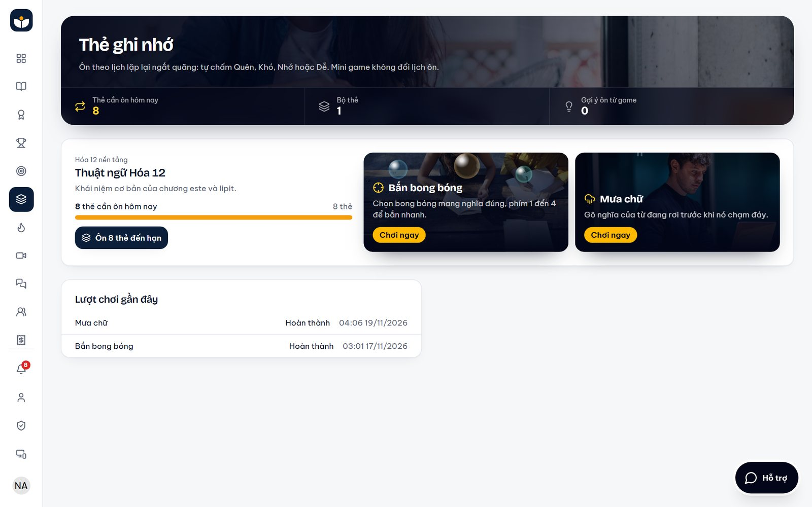<br/><sub><b>Thẻ ghi nhớ</b>: ôn thẻ đến hạn, chọn mini game</sub></td>
    <td>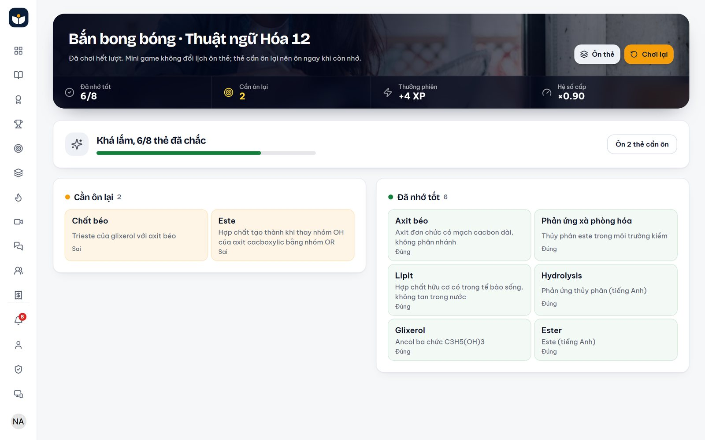<br/><sub><b>Kết quả Bắn bong bóng</b>: điểm, XP nhận được, thẻ cần ôn lại</sub></td>
  </tr>
  <tr>
    <td>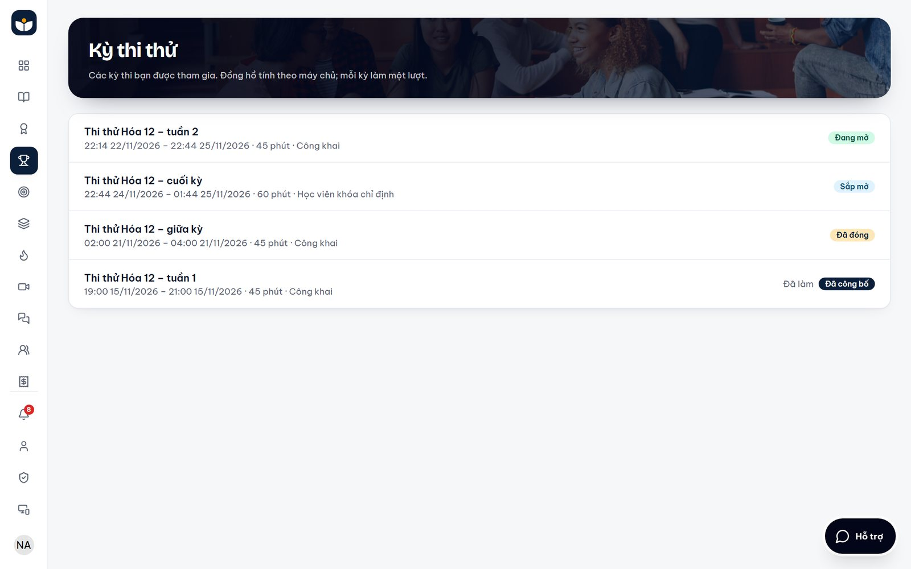<br/><sub><b>Thi thử</b>: kỳ đang mở, sắp mở, đã công bố kết quả</sub></td>
    <td>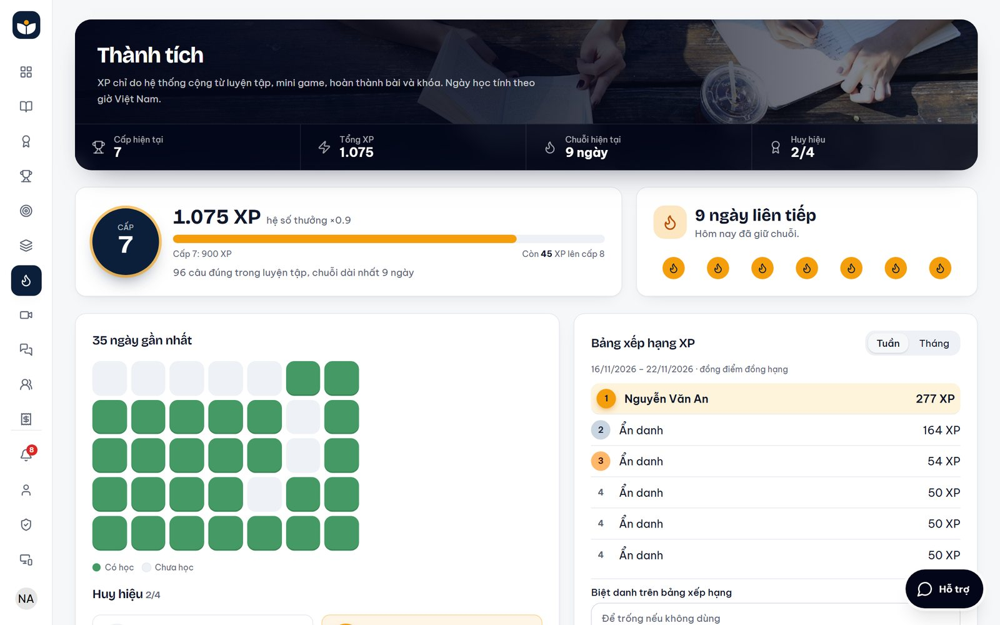<br/><sub><b>Thành tích</b>: cấp độ, chuỗi ngày học, huy hiệu, bảng xếp hạng XP</sub></td>
  </tr>
</table>

### Giáo viên

<table>
  <tr>
    <td width="50%">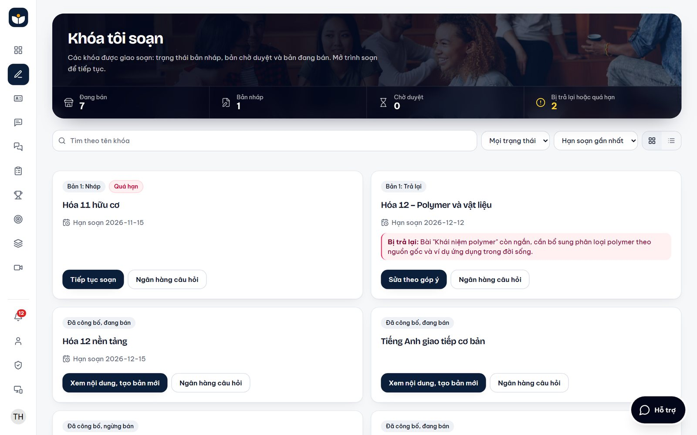<br/><sub><b>Khóa tôi soạn</b>: trạng thái từng phiên bản, nhận xét khi bị trả lại</sub></td>
    <td width="50%">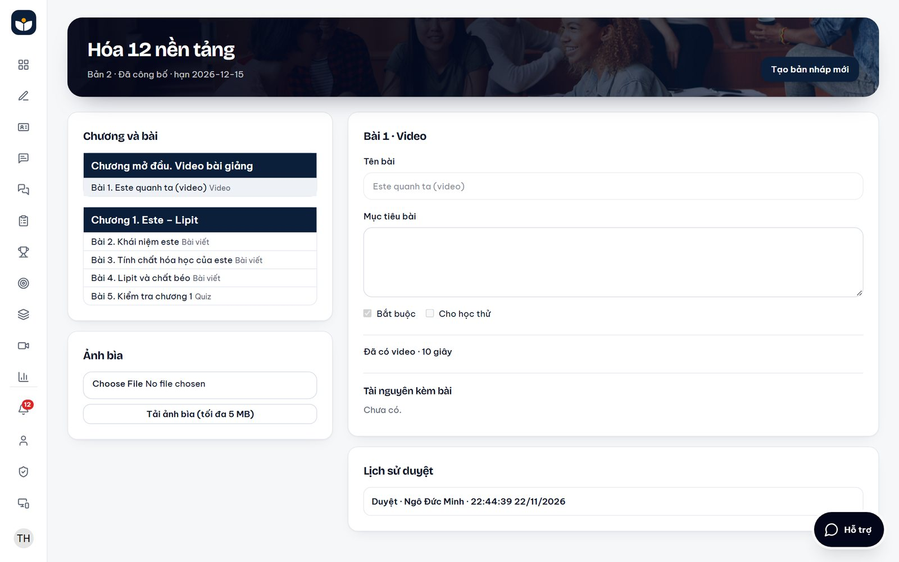<br/><sub><b>Soạn khóa học</b>: chương, bài, video, tài liệu, ngân hàng câu hỏi</sub></td>
  </tr>
</table>

### Giáo vụ và phụ huynh

<table>
  <tr>
    <td width="50%">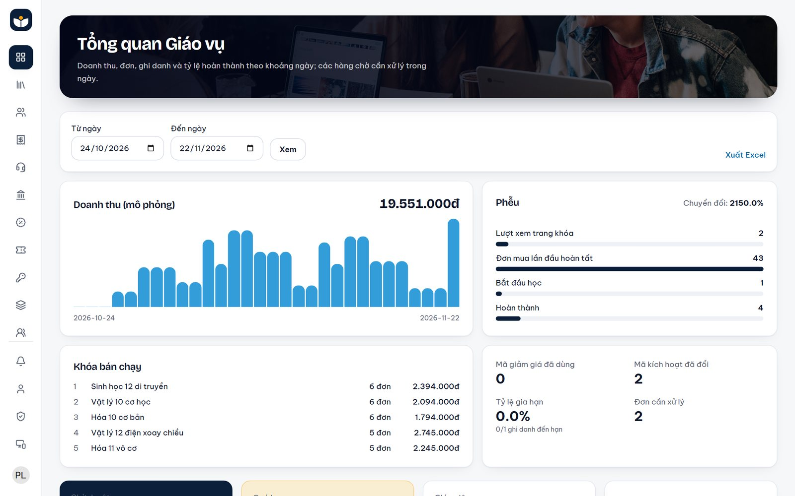<br/><sub><b>Tổng quan</b>: doanh thu, phễu chuyển đổi, khóa bán chạy, việc cần xử lý</sub></td>
    <td width="50%">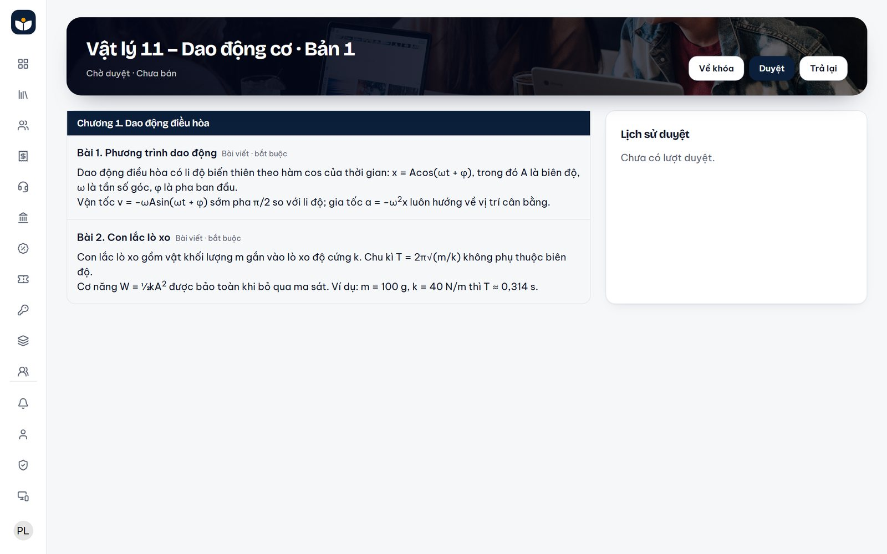<br/><sub><b>Duyệt khóa học</b>: xem trước nội dung, duyệt hoặc trả lại kèm nhận xét</sub></td>
  </tr>
  <tr>
    <td>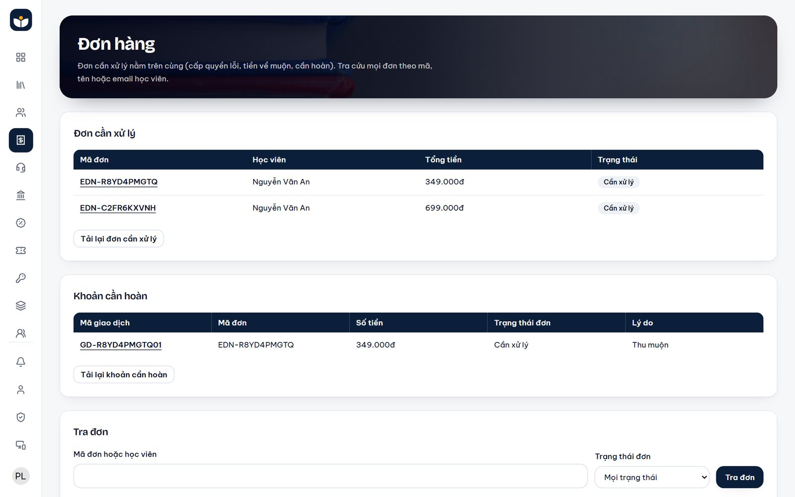<br/><sub><b>Đơn hàng</b>: đơn cần xử lý, khoản cần hoàn, tra cứu đơn</sub></td>
    <td>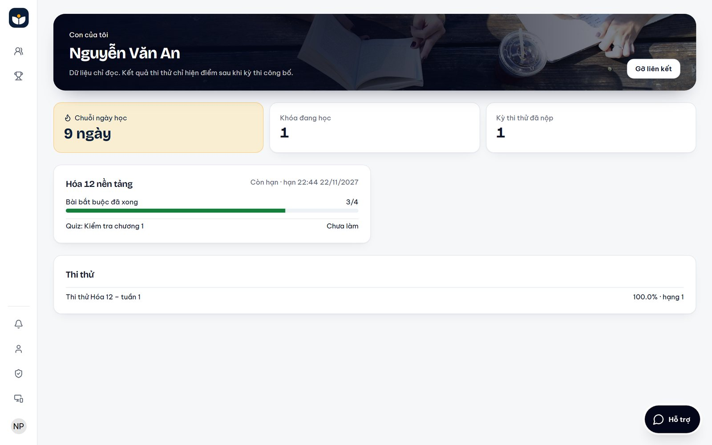<br/><sub><b>Phụ huynh</b>: chuỗi ngày học, tiến độ từng khóa, kết quả thi của con</sub></td>
  </tr>
</table>

### Trên điện thoại

Giao diện co giãn theo màn hình và cài được như ứng dụng (PWA).

<p>
  
  &nbsp;&nbsp;
  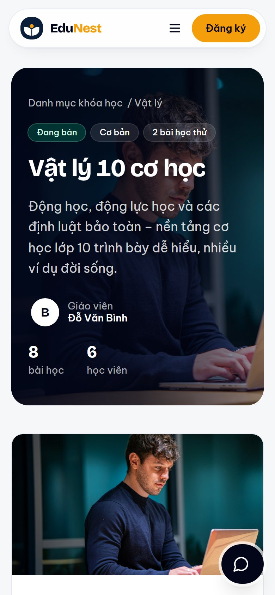
</p>

## Vai trò

| Vai       | Khu vực                                 | Làm được gì                                                                                                                                     |
| --------- | --------------------------------------- | ----------------------------------------------------------------------------------------------------------------------------------------------- |
| Khách     | `/`, `/courses`, `/teachers`, `/verify` | Xem khóa học và giáo viên, tra cứu chứng nhận, chat với tư vấn viên                                                                             |
| Học viên  | `/student`                              | Mua khóa, học, làm kiểm tra, thi thử, luyện tập, thẻ ghi nhớ, mini game, cộng đồng, giới thiệu bạn bè                                           |
| Giáo viên | `/teacher`                              | Soạn khóa và ngân hàng câu hỏi, trả lời hỏi đáp, mở buổi học trực tiếp, xem kết quả học viên                                                    |
| Giáo vụ   | `/academic`                             | Duyệt khóa, phân công giáo viên theo chuyên môn, quản lý đơn hàng, hoàn tiền, mã kích hoạt, mã giảm giá, kỳ thi, hoa hồng, kiểm duyệt cộng đồng |
| Quản trị  | `/admin`                                | Người dùng và vai trò, danh mục, huy hiệu, cấu hình hệ thống, doanh thu, nhật ký kiểm toán                                                      |
| Phụ huynh | `/guardian`                             | Liên kết với tài khoản con, xem tiến độ và báo cáo tuần                                                                                         |

## Chức năng theo phân hệ

<details>
<summary><b>Xem đầy đủ 29 phân hệ</b></summary>

| Mã  | Phân hệ                                                        |
| --- | -------------------------------------------------------------- |
| M01 | Tài khoản, xác thực, xác thực 2 lớp, phân quyền theo vai       |
| M02 | Danh mục, cấp độ, thẻ, hồ sơ và chuyên môn giáo viên           |
| M03 | Biên soạn khóa học                                             |
| M04 | Câu hỏi và quy tắc chấm                                        |
| M05 | Duyệt, công bố, quản lý phiên bản                              |
| M06 | Danh mục công khai, tìm kiếm, trang khóa học, trang giáo viên  |
| M07 | Đơn hàng, thanh toán, cấp quyền                                |
| M08 | Thời hạn truy cập và gia hạn                                   |
| M09 | Trình học và tiến độ                                           |
| M10 | Bài kiểm tra, hoàn thành khóa, chứng nhận                      |
| M11 | Báo cáo, nhật ký, tác vụ nền                                   |
| M12 | Mã giảm giá, giỏ hàng, danh sách yêu thích                     |
| M13 | Mã kích hoạt khóa học                                          |
| M14 | Đánh giá khóa học                                              |
| M15 | Thông báo thời gian thực, email, thông báo đẩy                 |
| M16 | Chống chia sẻ tài khoản, watermark                             |
| M17 | Hỏi đáp theo bài, ghi chú                                      |
| M18 | Thi thử trực tuyến, xếp hạng, vinh danh                        |
| M19 | Phân tích kết quả cho giáo viên, dashboard giáo vụ             |
| M20 | Luyện tập                                                      |
| M21 | XP, cấp độ, chuỗi ngày, huy hiệu, bảng xếp hạng                |
| M22 | Thẻ ghi nhớ và mini game                                       |
| M23 | Phụ huynh                                                      |
| M24 | Gói combo, tiếp thị liên kết                                   |
| M25 | Trợ lý AI                                                      |
| M26 | Buổi học trực tiếp                                             |
| M27 | Cộng đồng                                                      |
| M28 | Chuyển khoản VietQR qua webhook, API cho ứng dụng di động, PWA |
| M29 | Chat hỗ trợ                                                    |

</details>

## Công nghệ

| Tầng       | Công nghệ                                                                                           |
| ---------- | --------------------------------------------------------------------------------------------------- |
| Máy chủ    | PHP 8.3, Laravel 13, Fortify (xác thực, 2FA), Sanctum (API), Reverb (WebSocket), hàng đợi trên CSDL |
| Giao diện  | Inertia 3, React 19, TypeScript, Tailwind CSS 4, shadcn/ui, Wayfinder                               |
| Dữ liệu    | MySQL 8.4 với khóa dòng, ràng buộc CHECK, mức cô lập READ COMMITTED                                 |
| Tích hợp   | Google Gemini, MoMo, VietQR (chuẩn EMVCo), Web Push (VAPID), SMTP                                   |
| Chất lượng | Pest, PHPStan (Larastan), Pint, ESLint và Prettier qua Vite+, GitHub Actions                        |

## Bắt đầu nhanh

**Yêu cầu:** PHP 8.3 (cần `pdo_mysql`, `mbstring`, `openssl`, `gd`, `intl`, `zip`, `bcmath`), Composer 2, Node.js 22 và MySQL 8.4. Trên Windows, [Laragon](https://laragon.org) có sẵn PHP, MySQL và Composer.

```bash
git clone https://github.com/tanhung-05/edunest-do-an.git edunest
cd edunest
composer setup             # cài thư viện, tạo .env, sinh APP_KEY, migrate, build giao diện
```

Tạo CSDL `edunest` (utf8mb4) và kiểm tra phần `DB_*` trong `.env`. Sau đó nạp dữ liệu mẫu:

```bash
php artisan migrate:fresh --seed
php artisan storage:link
```

Chạy ứng dụng, mỗi lệnh trong một terminal:

```bash
php artisan serve                                                  # http://127.0.0.1:8000
php artisan queue:listen --queue=default,grants,media --tries=1    # cấp quyền học, email, thông báo
php artisan reverb:start                                           # thông báo thời gian thực, chat
php artisan schedule:work                                          # tác vụ định kỳ
npm run dev                                                        # chỉ cần khi sửa giao diện
```

> [!IMPORTANT]
> Hàng đợi phải nghe đủ ba kênh `default`, `grants`, `media`. Nếu thiếu kênh `grants`, đơn đã thanh toán sẽ không được cấp quyền học.

## Tài khoản dùng thử

Dữ liệu mẫu có 14 khóa học với nội dung thật và khoảng 40 học viên đang học. Đơn hàng, phiên bản khóa, kỳ thi, mã giảm giá, hỏi đáp, cộng đồng và mini game đều có dữ liệu ở đủ các trạng thái. Mọi tài khoản dùng mật khẩu `matkhau123`.

| Vai       | Email                             |
| --------- | --------------------------------- |
| Quản trị  | `quang.le.edunest@mailinator.com` |
| Giáo vụ   | `lan.pham.edunest@mailinator.com` |
| Giáo viên | `hoa.tran.edunest@mailinator.com` |
| Học viên  | `an.nguyen.2007@mailinator.com`   |
| Phụ huynh | `phuc.nguyen.ph@mailinator.com`   |

> [!NOTE]
>
> - Giáo vụ và Quản trị phải bật xác thực 2 lớp ở lần đăng nhập đầu.
> - Thư gửi tới địa chỉ `@mailinator.com` đọc được công khai trên mailinator.com.
> - Đơn chờ thanh toán, kỳ thi và buổi học trực tiếp tính theo thời điểm nạp dữ liệu. Muốn các mốc này còn mới thì nạp lại.

Muốn bắt đầu với CSDL trống thì tạo tài khoản quản trị đầu tiên bằng lệnh:

```bash
php artisan edunest:admin:create admin@example.com --name="Quản trị"
```

## Cấu hình dịch vụ ngoài

Mọi dịch vụ ngoài đều tùy chọn. Khi chưa cấu hình, ứng dụng vẫn chạy với cổng thanh toán mô phỏng và AI mô phỏng.

Trên Windows, chạy script dưới đây để nhập khóa. Script ẩn ký tự khi gõ và ghi vào `.env`:

```powershell
powershell -ExecutionPolicy Bypass -File scripts/cau-hinh-khoa.ps1
```

| Dịch vụ        | Biến môi trường                                                                                     | Ghi chú                                                  |
| -------------- | --------------------------------------------------------------------------------------------------- | -------------------------------------------------------- |
| Email          | `MAIL_MAILER=smtp`, `MAIL_HOST`, `MAIL_PORT`, `MAIL_USERNAME`, `MAIL_PASSWORD`, `MAIL_FROM_ADDRESS` | Với Gmail, dùng mật khẩu ứng dụng 16 ký tự               |
| Trợ lý AI      | `GEMINI_API_KEY`, `GEMINI_MODEL`                                                                    | Kiểm tra kết nối: `php artisan edunest:ai-check`         |
| MoMo           | `MOMO_ENDPOINT`, `MOMO_PARTNER_CODE`, `MOMO_ACCESS_KEY`, `MOMO_SECRET_KEY`                          | Có khóa thì trang đơn hàng hiện thêm lựa chọn MoMo       |
| VietQR         | `BANK_BIN`, `BANK_SIM_BANK`, `BANK_SIM_ACCOUNT`, `BANK_SIM_ACCOUNT_NAME`                            | Đủ 4 giá trị thì mã QR quét được bằng ứng dụng ngân hàng |
| Thông báo đẩy  | `VAPID_SUBJECT`, `VAPID_PUBLIC_KEY`, `VAPID_PRIVATE_KEY`                                            | Sinh khóa: `php artisan edunest:vapid`                   |
| Thời gian thực | `REVERB_*`, `VITE_REVERB_*`                                                                         | Đổi xong chạy lại `npm run build`                        |

Sau khi sửa `.env`, chạy `php artisan config:clear` rồi khởi động lại hàng đợi.

## Lệnh Artisan

| Lệnh                                              | Việc                                       |
| ------------------------------------------------- | ------------------------------------------ |
| `edunest:expire-overdue-orders`                   | Đóng đơn quá hạn thanh toán                |
| `edunest:recover-granting-orders`                 | Cấp lại quyền cho đơn bị kẹt               |
| `edunest:commerce {reminders\|promotions\|codes}` | Nhắc giỏ hàng, chạy khuyến mãi, hết hạn mã |
| `edunest:exams`                                   | Mở, đóng kỳ thi và công bố kết quả         |
| `edunest:practice`                                | Lịch luyện tập                             |
| `edunest:guardian-reports`                        | Gửi báo cáo tuần cho phụ huynh             |
| `learning:finalize-overdue-attempts`              | Nộp các bài làm quá giờ                    |
| `learning:aggregate-daily-report`                 | Tổng hợp số liệu học tập theo ngày         |
| `edunest:ops-status`                              | Xem tình trạng hàng đợi và tác vụ nền      |
| `edunest:demo-exam --close-in=2`                  | Tạo kỳ thi đóng sau vài phút để thử nhanh  |
| `edunest:admin:reset-2fa {email}`                 | Đặt lại xác thực 2 lớp cho một tài khoản   |

`php artisan schedule:work` tự chạy các lệnh định kỳ ở trên.

## Kiểm thử

Bộ test dùng CSDL riêng `edunest_test`, cần tạo trước khi chạy.

```bash
php artisan test               # hơn 900 test Pest
composer lint                  # định dạng PHP (Pint)
vendor/bin/phpstan analyse     # phân tích tĩnh
npm run check                  # lint và định dạng TypeScript
npm run types:check            # kiểm tra kiểu
composer ci:check              # chạy đủ các bước như CI
```

GitHub Actions chạy `composer ci:check` trên MySQL 8.4 mỗi lần đẩy lên `main`.

## Cấu trúc mã nguồn

```
app/
├── Actions/M01..M29/     Nghiệp vụ theo phân hệ, mọi thay đổi dữ liệu đi qua đây
├── Http/Controllers/     Theo vai: Student, Teacher, Academic, Admin, Guardian, PublicSite; Gateway, Webhook
├── Models/M01..M29/      Model Eloquent
├── Enums/                Trạng thái và loại
├── Jobs/, Notifications/ Tác vụ nền, thông báo
└── Support/              Cổng thanh toán, VietQR, quyền truy cập bài học…
database/
├── migrations/
└── seeders/              Dữ liệu mẫu; nội dung khóa học ở seeders/du-lieu/
resources/js/
├── pages/                Trang Inertia theo vai
└── components/           Thành phần giao diện dùng chung
routes/                   web.php, console.php (lịch tác vụ), channels.php
tests/                    Feature và Unit (Pest)
```

## Xử lý sự cố

| Hiện tượng                                         | Cách xử lý                                                                                      |
| -------------------------------------------------- | ----------------------------------------------------------------------------------------------- |
| Đã thanh toán nhưng chưa vào học được              | Hàng đợi chưa chạy hoặc thiếu kênh `grants`                                                     |
| Sửa giao diện không thấy thay đổi                  | Chạy `npm run build`, hoặc dùng `npm run dev`                                                   |
| Không có thông báo thời gian thực                  | Chạy `php artisan reverb:start` và kiểm tra biến `REVERB_*`                                     |
| Lỗi tạo khóa EC khi bật thông báo đẩy trên Windows | Thêm `OPENSSL_CONF=<thư mục PHP>/extras/ssl/openssl.cnf` vào `.env`, rồi khởi động lại hàng đợi |
| Mất mã 2FA của tài khoản quản trị                  | `php artisan edunest:admin:reset-2fa <email>`                                                   |
| Đổi `.env` không có tác dụng                       | `php artisan config:clear`                                                                      |
