# Báo cáo đồ án môn Lập trình mã nguồn mở

## EduNest — Nền tảng học trực tuyến có biên soạn, duyệt và bán khóa học

| Mục | Nội dung |
|---|---|
| Học phần | Lập trình mã nguồn mở |
| Sản phẩm | Ứng dụng web EduNest (Laravel 13, React 19, MySQL 8.4) |
| Mã nguồn | Thư mục `edunest/` |
| Tài liệu gốc | Đặc tả `docs/dac-ta-ung-dung-EduNest-v1.5.md`; nghiệp vụ `docs/nghiep-vu/`; thiết kế `docs/thiet-ke/` |
| Ngày | 21/11/2026 |

> Bản Markdown này là nội dung báo cáo. Khi có mẫu trình bày của khoa, nội dung được chuyển sang Word theo mẫu (trang bìa, mục lục, đánh số hình và bảng).

---

## Chương 1. Giới thiệu đề tài

### 1.1. Bài toán

Các trung tâm dạy học trực tuyến nhỏ cần một chỗ để giáo viên soạn khóa học, giáo vụ duyệt trước khi bán, học viên mua và học, và nhà trường theo dõi kết quả. Công cụ phổ thông (nhóm chat, ổ đĩa chung, biểu mẫu) không kiểm soát được nội dung trước khi bán, không chống chia sẻ tài khoản, không chấm và cấp chứng nhận tự động.

EduNest giải bài toán đó trong một ứng dụng web:
- Giáo viên soạn khóa (bài đọc, video, PDF, quiz) theo phiên bản.
- Giáo vụ duyệt, công bố, bật bán, xử lý đơn lỗi và báo cáo.
- Học viên tìm, học thử, mua, học theo lộ trình, làm quiz, nhận chứng nhận có mã xác minh.
- Quản trị quản lý tài khoản, cấu hình và nhật ký.
- Phụ huynh theo dõi con (tầng mở rộng).

### 1.2. Mục tiêu

1. Đủ nghiệp vụ cho sáu vai, đi trọn bốn luồng demo A, B, C, D (đặc tả §14).
2. Không sai tiền, quyền và điểm: mọi luồng nhạy cảm có khóa dòng, chống ghi trùng và test tự động.
3. Giao diện dùng được trên điện thoại (390px) và máy tính.
4. Mã nguồn mở, dựng bằng công cụ mã nguồn mở, có CI.

### 1.3. Phạm vi theo ba tầng

| Tầng | Phân hệ | Nội dung chính |
|---|---|---|
| L — lõi | M01–M11 | Tài khoản và phân quyền; danh mục; biên soạn; câu hỏi; duyệt và phiên bản; cửa hàng; đơn và thanh toán mô phỏng; thời hạn; trình học; quiz và chứng nhận; báo cáo và nhật ký |
| N — nâng cao | M12–M19 | Giỏ hàng và mã giảm giá; mã kích hoạt; đánh giá; thông báo thời gian thực; chống chia sẻ tài khoản; hỏi đáp và ghi chú; thi thử và xếp hạng; phân tích kết quả |
| E — mở rộng | M20–M28 | Luyện tập; XP, chuỗi ngày, huy hiệu; thẻ ghi nhớ và mini game; phụ huynh; combo và tiếp thị liên kết; trợ lý AI (Gemini); buổi học trực tiếp; cộng đồng; chuyển khoản QR, API di động, PWA |
| Bổ sung P10 | M29 | Chat trực tiếp với nhân viên (cả Khách chưa đăng nhập), hộp chat nổi tư vấn AI, thông báo thời gian thực qua Reverb |

Danh sách đầy đủ ở đặc tả §4. Xây theo 10 mốc P0–P9 (đặc tả §13); cả 10 mốc đã xong. Mốc P10 thay các phần giả lập bằng phần chạy thật (AI, thời gian thực, email, video) và thêm phân hệ M29.

---

## Chương 2. Phân tích yêu cầu

### 2.1. Tác nhân

| Vai | Mô tả |
|---|---|
| Khách | Chưa đăng nhập: tìm khóa, học thử, xác minh chứng nhận, tư vấn AI |
| Học viên | Mua, học, làm bài, thi thử, luyện tập, cộng đồng |
| Giáo viên | Soạn khóa được giao, ngân hàng câu hỏi, trả lời hỏi đáp, kỳ thi, buổi trực tiếp |
| Giáo vụ | Giao soạn, duyệt, công bố, bán, xử lý đơn và hoàn tiền, kiểm duyệt, báo cáo |
| Quản trị | Tài khoản, vai trò, cấu hình, danh mục nền, nhật ký thao tác |
| Phụ huynh | Liên kết với con bằng mã mời, xem dữ liệu chỉ đọc, nhận báo cáo tuần |

Một tài khoản có thể giữ nhiều vai. Vai nhân sự (Giáo vụ, Quản trị) bắt buộc xác thực hai lớp.

### 2.2. Use Case

Hệ thống có **103 use case** chia theo vai, mỗi use case dẫn tới bước cụ thể trong quy trình nghiệp vụ. Bảng và sơ đồ use case từng vai: [`docs/nghiep-vu/03-use-case.md`](../nghiep-vu/03-use-case.md).

Sơ đồ use case tổng quát (rút gọn, chỉ nhóm chức năng):

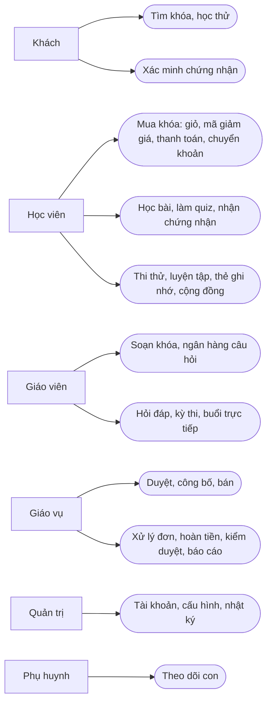

### 2.3. Quy trình và quy tắc nghiệp vụ

- 30 quy trình QT-01 → QT-30, mỗi quy trình có sơ đồ làn, luồng chính, luồng thay thế, ngoại lệ và tiêu chí nghiệm thu Given/When/Then: [`docs/nghiep-vu/`](../nghiep-vu/01-danh-muc-quy-trinh.md).
- 616 quy tắc nghiệp vụ (BR) và 1.614 tiêu chí nghiệm thu (AC).
- Ma trận phân quyền, ma trận CRUD và ma trận truy vết nối BR → AC → test.

### 2.4. Yêu cầu phi chức năng chính

| Yêu cầu | Cách đáp ứng |
|---|---|
| Đúng tiền | Tiền lưu số nguyên VND; mọi bước ghi thanh toán qua một chỗ (`ReconcilePayment`) có khóa đơn và chống ghi trùng theo mã giao dịch |
| Đúng quyền | Policy theo model, kiểm lại vai và trạng thái tài khoản ngay tại điểm ghi |
| Chịu đồng thời | Khóa dòng theo thứ tự cố định, mức cô lập READ COMMITTED, tự thử lại khi deadlock; test hai tiến trình (`tests/Concurrency`) |
| Chống chia sẻ tài khoản | Giới hạn thiết bị, watermark video, URL ký gắn phiên |
| Bảo mật | 2FA nhân sự, CSRF, lọc HTML, tệp riêng tư, tiêu đề bảo mật, audit gói (xem Chương 5) |
| Dùng trên điện thoại | Bố cục đáp ứng, kiểm 390px không cuộn ngang |

---

## Chương 3. Thiết kế

### 3.1. Kiến trúc

Ứng dụng nguyên khối (monolith) theo mô hình Laravel + Inertia: máy chủ dựng dữ liệu trang, React hiển thị, không tách API riêng cho web. Cùng bộ mã chạy ba tiến trình: web, worker hàng đợi và bộ lập lịch.

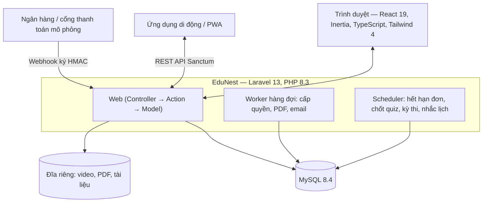

Lớp mã:
- **Controller** chỉ nhận yêu cầu, kiểm hợp lệ, gọi Action, trả trang.
- **Action** (`app/Actions/Mxx`) chứa nghiệp vụ ghi, chạy trong giao dịch có khóa dòng.
- **Query** (`app/Queries/Mxx`) chứa truy vấn đọc cho trang.
- **Policy** kiểm quyền theo model.

Chi tiết: [`docs/thiet-ke/00-kien-truc-tong-the.md`](../thiet-ke/00-kien-truc-tong-the.md). 12 quyết định kiến trúc (ADR) ở [`docs/thiet-ke/adr/`](../thiet-ke/adr/README.md), ví dụ ADR-003 tiền VND và làm tròn, ADR-007 khóa dòng và chống ghi trùng, ADR-009 lưu tệp và URL ký.

### 3.2. Cơ sở dữ liệu (ERD)

CSDL có **107 bảng** (gồm bảng hệ thống của Laravel). ERD được chia theo cụm nghiệp vụ:

| Cụm | Tài liệu | Hình |
|---|---|---|
| Khung toàn hệ thống | [`01-erd-khung.md`](../thiet-ke/01-erd-khung.md) | `docs/thiet-ke/mermaid-svg/01-erd-khung-01.svg` … `-10.svg` |
| Chi tiết tầng L | [`02-erd-chi-tiet-L.md`](../thiet-ke/02-erd-chi-tiet-L.md) | — |
| Tầng N (P5, P6) | [`02b`](../thiet-ke/02b-erd-chi-tiet-N-P5.md), [`02c`](../thiet-ke/02c-erd-chi-tiet-N-P6.md) | — |
| Tầng E (P7, P8) | [`02d`](../thiet-ke/02d-thiet-ke-chi-tiet-E-P7.md), [`02e`](../thiet-ke/02e-thiet-ke-chi-tiet-E-P8.md) | — |

Ví dụ cụm khóa học, đơn hàng và ghi danh (rút gọn):

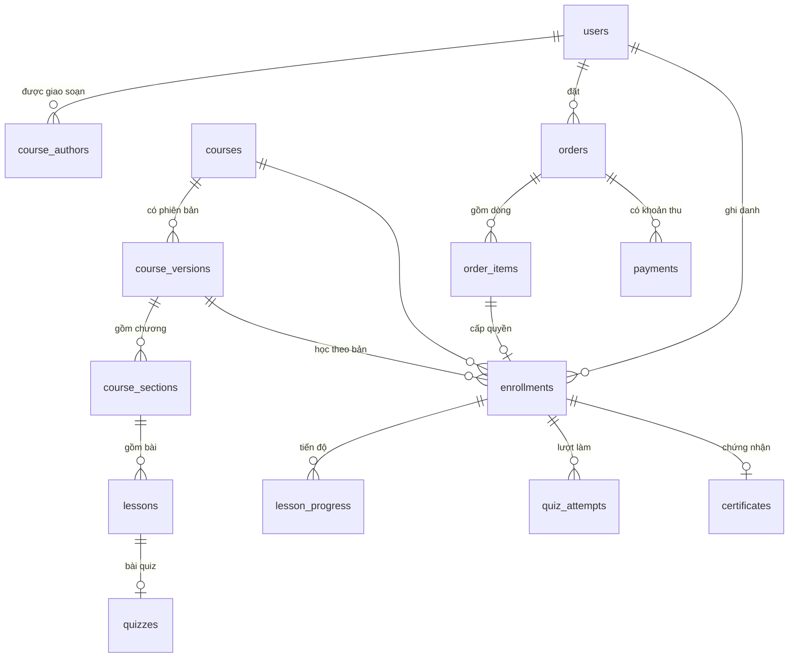

Quy ước: khóa chính số tự tăng, mã công khai riêng cho đơn và chứng nhận; giờ lưu UTC, hiển thị giờ Việt Nam; dữ liệu cần giữ lịch sử (giá lúc đặt, câu hỏi lúc thi) được chụp lại vào dòng.

### 3.3. Máy trạng thái

Các đối tượng chính có máy trạng thái rõ ràng, chuyển trạng thái chỉ qua Action: phiên bản khóa (Nháp → Chờ duyệt → Đã công bố / Trả lại), đơn hàng (Chờ thanh toán → Đang cấp quyền → Hoàn tất; Cần xử lý; Hết hạn; Đã hủy), khoản thanh toán, lượt quiz, kỳ thi. Sơ đồ: [`03-may-trang-thai.md`](../thiet-ke/03-may-trang-thai.md) và `mermaid-svg/03-may-trang-thai-01..04.svg`.

### 3.4. Phân quyền

Ma trận vai × thao tác: [`04-phan-quyen.md`](../thiet-ke/04-phan-quyen.md). Middleware `role:` lọc theo vai còn hiệu lực; Policy kiểm theo đối tượng (giáo viên chỉ sửa khóa đang được giao, giáo vụ không tự duyệt khóa mình soạn); Action đọc lại vai dưới khóa để chặn thao tác của tài khoản vừa bị khóa.

### 3.5. Màn hình

Đặc tả từng màn hình theo vai ở [`docs/thiet-ke/06-man-hinh/`](../thiet-ke/06-man-hinh/). Hệ thiết kế v5: nền trung tính, ảnh thật, màu thương hiệu dùng tiết chế, thanh điều hướng biểu tượng.

---

## Chương 4. Cài đặt

### 4.1. Công nghệ mã nguồn mở

| Lớp | Công nghệ |
|---|---|
| Máy chủ | PHP 8.3, Laravel 13, Fortify (đăng nhập, 2FA), Sanctum (API), Reverb (WebSocket) |
| Giao diện | React 19, Inertia 3, TypeScript, Tailwind CSS 4, Radix UI, GSAP |
| CSDL | MySQL 8.4 |
| Thư viện | PhpSpreadsheet (Excel), BaconQrCode (QR), brick/math (tính điểm chính xác) |
| Chất lượng | Pest (test), Larastan (phân tích tĩnh), Pint (định dạng PHP), Vite+ (lint, định dạng TS), GitHub Actions |

### 4.2. Quy mô mã

| Hạng mục | Số lượng |
|---|---|
| Tệp PHP trong `app/` | 453 |
| Trang và thành phần React (`.tsx`) | 195 |
| Tuyến (route) | khoảng 320 |
| Tệp test | 65 (gần 870 test) |
| Commit theo mốc | 26 |

### 4.3. Một số kỹ thuật đáng chú ý

1. **Ghi thanh toán một chỗ.** Thẻ mô phỏng và chuyển khoản ngân hàng đều đi qua `ReconcilePayment`: kiểm chữ ký HMAC, khóa đơn, chống ghi trùng theo mã giao dịch, phân loại khoản đúng / sai tiền / thu trùng / muộn. Khoản sai tiền không bao giờ cấp quyền học.
2. **Cấp quyền qua hàng đợi.** Thanh toán xong, đơn chuyển "Đang cấp quyền", Job `GrantOrder` tạo ghi danh trong giao dịch; lỗi thì chuyển "Cần xử lý" cho giáo vụ, có tác vụ nền tự phục hồi.
3. **Phiên bản khóa học.** Học viên cũ vẫn học bản đã mua; giáo viên sửa bản mới không ảnh hưởng người đang học; chuyển bản giữ tiến độ bài không đổi.
4. **Quiz chấm bằng số hữu tỉ** (brick/math) để điểm phần trăm không lệch do số thực.
5. **XP idempotent.** Mỗi nguồn XP có khóa duy nhất, chạy lại không cộng trùng.
6. **Chống chia sẻ tài khoản.** Giới hạn thiết bị, cookie thiết bị, URL ký gắn phiên, watermark tên người học trên video.
7. **Trợ lý AI có ràng buộc.** Mọi tính năng AI đi qua cổng `AiProvider`; bản thật gọi Gemini với đầu ra JSON theo lược đồ, chỉ dẫn hệ thống buộc chỉ tư vấn khóa trong danh mục và coi nội dung người dùng là dữ liệu; mã khóa AI trả về được lọc lại theo danh mục đang bán. Test dùng bộ giả lập nên không tốn phí.
8. **Thời gian thực.** Laravel Reverb phát thông báo và tin nhắn hỗ trợ qua kênh riêng có kiểm quyền; giao diện vẫn thăm dò định kỳ khi mất kết nối.

Hướng dẫn cài đặt: [`docs/huong-dan-cai-dat.md`](../huong-dan-cai-dat.md).

---

## Chương 5. Kiểm thử và đánh giá

### 5.1. Chiến lược

- Mỗi tiêu chí nghiệm thu quan trọng có test Pest mang mã AC trong tên test, để truy vết ngược về quy trình.
- Test đồng thời hai tiến trình cho các ca tranh chấp (DT-xx): hai lần thanh toán cùng lúc, hai yêu cầu hoàn thành bài cùng lúc, ...
- Phân tích tĩnh Larastan ở mức nghiêm ngặt, 0 lỗi.
- P9 bật chặn nạp lười (lazy loading) trong môi trường test để phát hiện truy vấn N+1.

Chi tiết: [`07-chien-luoc-test.md`](../thiet-ke/07-chien-luoc-test.md), ma trận AC ↔ test [`07a-ma-tran-ac-test.md`](../thiet-ke/07a-ma-tran-ac-test.md).

### 5.2. Kết quả theo mốc

| Mốc | Số test | Kết quả |
|---|---|---|
| P4 (Mốc 1) | 693 | 0 lỗi |
| P6 (Mốc 2) | 789 | 0 lỗi |
| P8 (Mốc 3) | 868 | 807 đạt, 0 lỗi, 61 bỏ qua (test trình duyệt cần Playwright) |
| P9 (hoàn thiện) | 871 | 0 lỗi sau sửa, 61 bỏ qua; thêm test bảo mật P9 |
| P10 (làm thật, chat) | 888 | 0 lỗi, 61 bỏ qua; thêm test AI Gemini (cả mô hình dự phòng), xem lại khóa đã học xong, chat hỗ trợ cả Khách, kênh phát, đọc video |

### 5.3. Rà bảo mật

Kết quả ở [`docs/thiet-ke/review/p9-bao-mat.md`](../thiet-ke/review/p9-bao-mat.md): rà tuyến ghi, CSRF, tải tệp, HTML người dùng, chuyển hướng, gán hàng loạt, phụ thuộc. Sửa hai lỗi (tệp tài liệu HTML có thể chạy mã trên miền ứng dụng; chuyển hướng thông báo ra ngoài), thêm tiêu đề bảo mật. `composer audit` và `npm audit` không có lỗ hổng.

### 5.4. Hiệu năng

Công cụ `edunest/scripts/dem-truy-van.php` đếm số câu SQL của 41 trang chính trên dữ liệu demo. P9 gom truy vấn ở danh sách khóa, giỏ hàng, đơn hàng, combo (nạp sẵn danh mục, giá khuyến mãi, tiến độ học, cờ quá hạn duyệt), giảm trang chủ từ 44 xuống 34 câu, danh mục từ 33 xuống 22, ghi danh của giáo vụ từ 93 xuống 65, bảng học tập học viên từ 58 xuống 51.

---

## Chương 6. Giao diện

Ảnh chụp ngày 21–22/11/2026 trên dữ liệu demo, máy tính 1440px và điện thoại 390px. Tệp gốc ở `docs/bao-cao/anh/`.

*Hình 6.1. Trang chủ (Khách)*

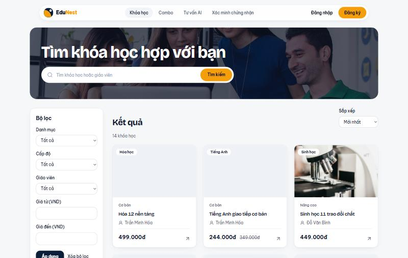

*Hình 6.2. Danh mục khóa học có bộ lọc (Khách)*

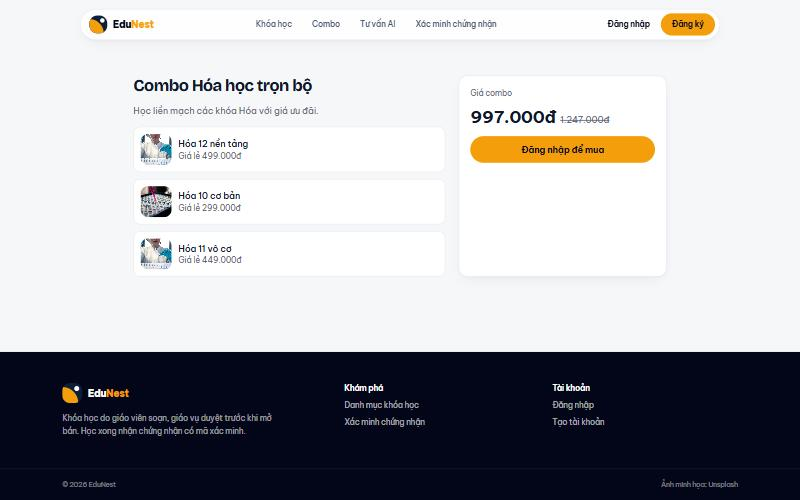

*Hình 6.3. Trang combo với giá combo và giá lẻ (Khách)*

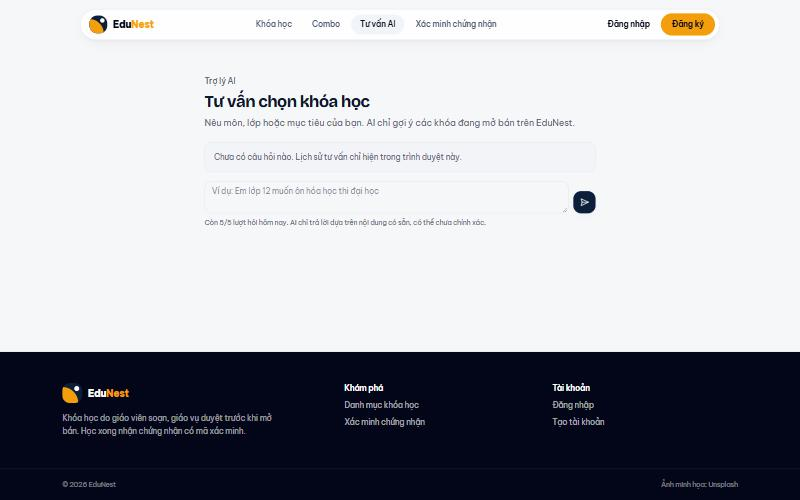

*Hình 6.4. Tư vấn chọn khóa bằng trợ lý AI (Khách)*

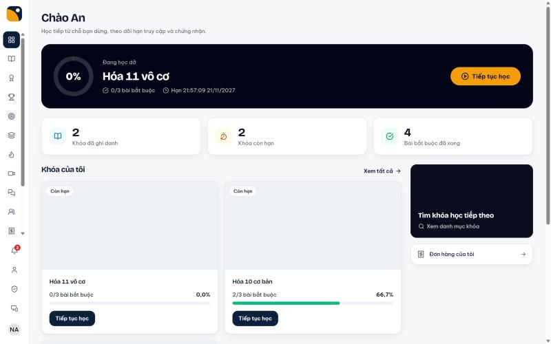

*Hình 6.5. Bảng học tập (Học viên)*

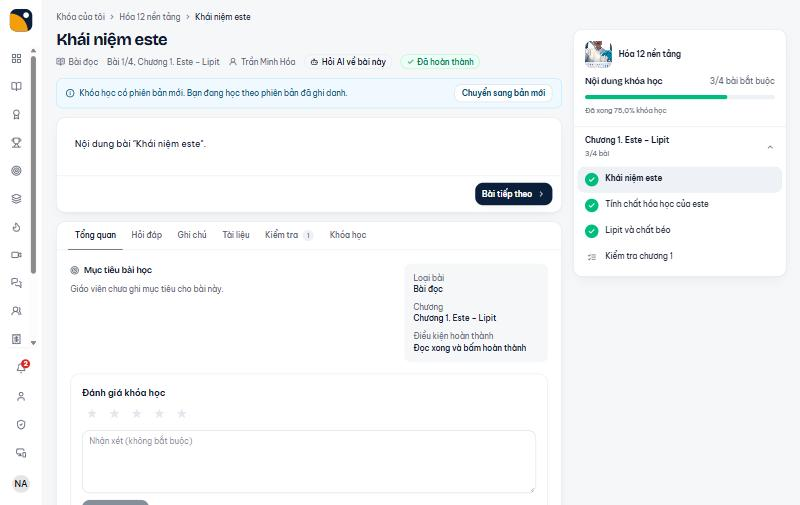

*Hình 6.6. Trình học: nội dung bài, đề cương, tiến độ, hỏi AI (Học viên)*

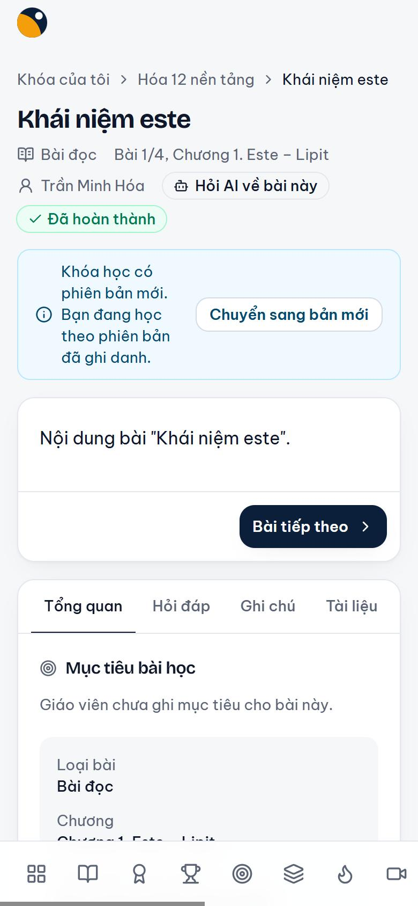

*Hình 6.7. Trình học trên điện thoại 390px (Học viên)*

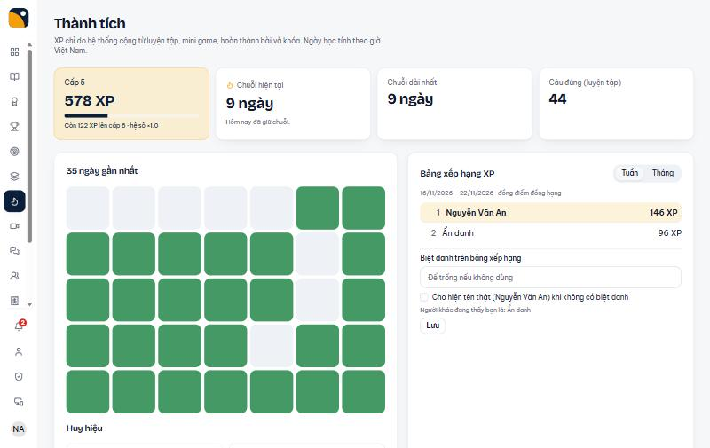

*Hình 6.8. Thành tích: XP, cấp, chuỗi ngày, lịch học, bảng xếp hạng (Học viên)*

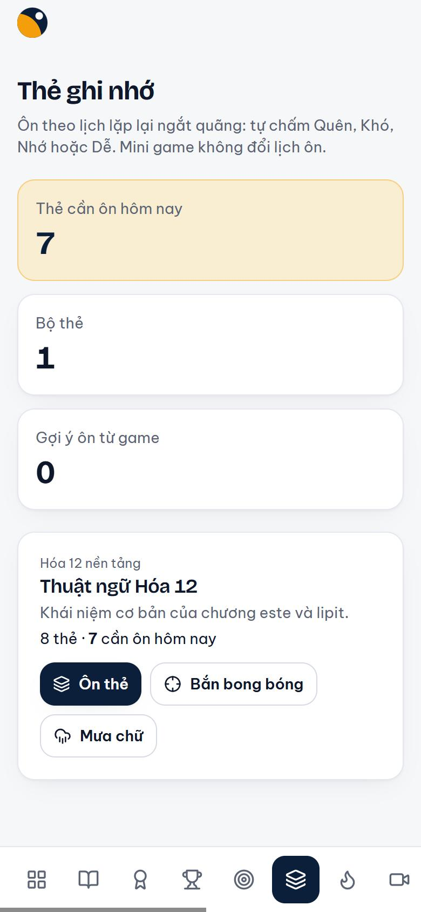

*Hình 6.9. Thẻ ghi nhớ và mini game trên điện thoại (Học viên)*

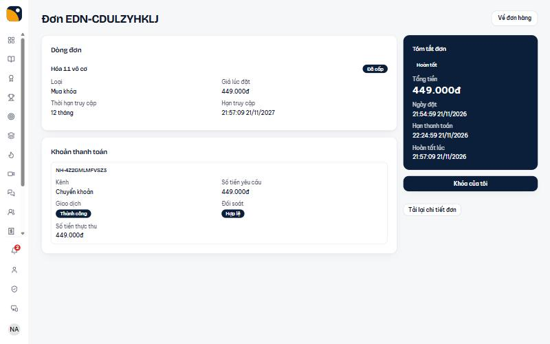

*Hình 6.10. Đơn hàng thanh toán bằng chuyển khoản đã hoàn tất (Học viên)*

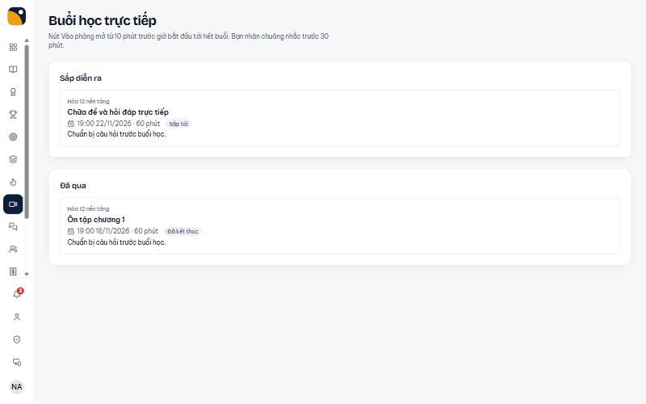

*Hình 6.11. Lịch buổi học trực tiếp (Học viên)*

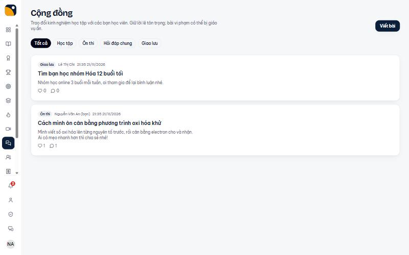

*Hình 6.12. Bảng tin cộng đồng (Học viên)*

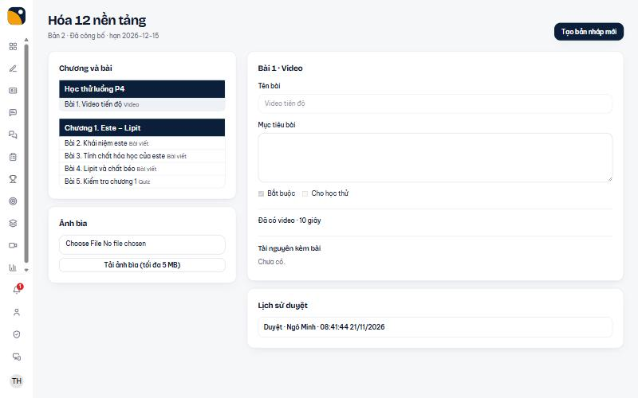

*Hình 6.13. Trình soạn khóa: chương, bài, ảnh bìa, lịch sử duyệt (Giáo viên)*

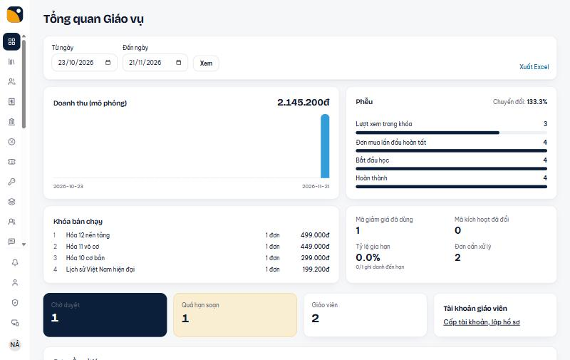

*Hình 6.14. Tổng quan Giáo vụ: doanh thu, phễu, khóa bán chạy, hàng chờ*

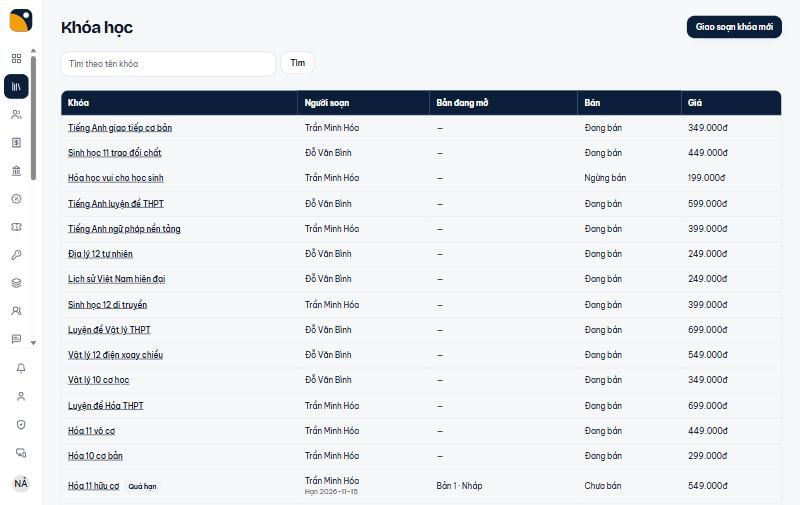

*Hình 6.15. Danh sách khóa và nhãn quá hạn soạn (Giáo vụ)*

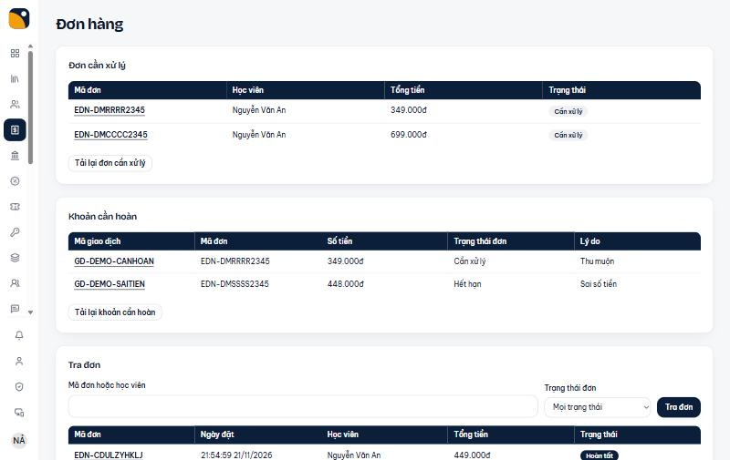

*Hình 6.16. Đơn cần xử lý, khoản cần hoàn, tra đơn (Giáo vụ)*

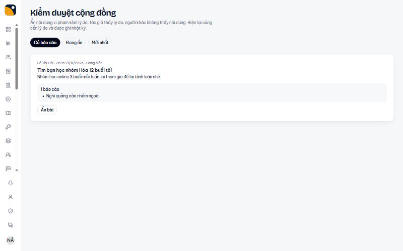

*Hình 6.17. Kiểm duyệt cộng đồng (Giáo vụ)*

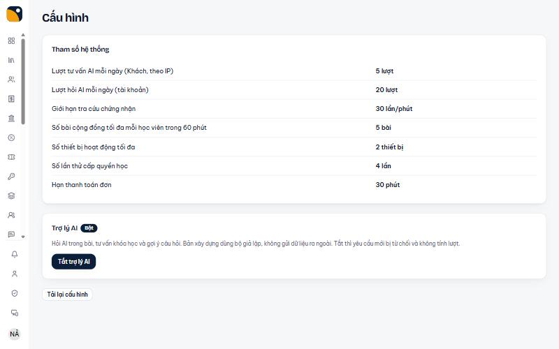

*Hình 6.18. Cấu hình hệ thống và bật/tắt trợ lý AI (Quản trị)*

*Hình 6.19. Hộp chat tư vấn AI (Gemini) gợi ý khóa kèm thẻ khóa (Khách)*

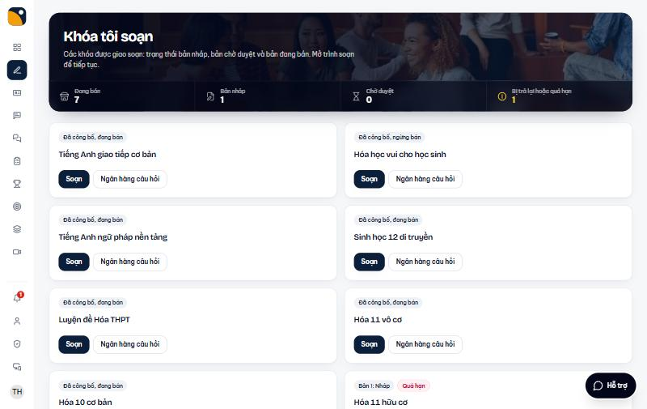

*Hình 6.20. Khóa tôi soạn với dải đầu trang và số tóm tắt (Giáo viên)*

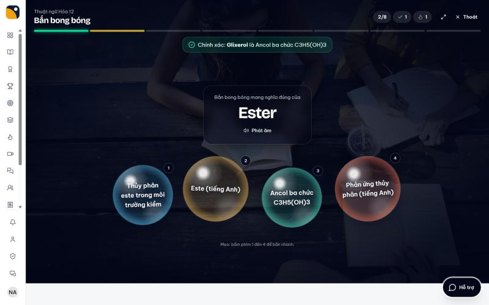

*Hình 6.21. Mini game Bắn bong bóng: phản hồi đúng/sai, chuỗi đúng liên tiếp, phím tắt 1–4 (Học viên)*

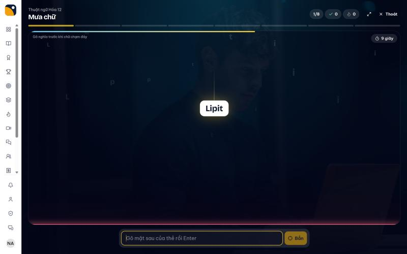

*Hình 6.22. Mini game Mưa chữ: chữ rơi, đồng hồ đếm ngược, vùng chạm đáy (Học viên)*

Các trang chính của cả sáu vai đã được kiểm ở 390px không cuộn ngang; nút chỉ có biểu tượng trên các trang nhân sự đều có nhãn cho trình đọc màn hình.

---

## Chương 7. Kết luận

### 7.1. Kết quả

- Hoàn thành 29 phân hệ qua 11 mốc, đi trọn bốn luồng demo; trợ lý AI chạy bằng mô hình thật, hỗ trợ trực tiếp có thời gian thực.
- Các luồng tiền, quyền, điểm có test tự động và test đồng thời.
- Tài liệu đầy đủ từ đặc tả, quy trình nghiệp vụ, thiết kế tới hướng dẫn cài đặt.

### 7.2. Hạn chế

- Thanh toán và chuyển khoản dùng bộ mô phỏng; chưa nối cổng và ngân hàng thật.
- Thông báo đẩy mới có phía trình duyệt, chưa có khóa VAPID để gửi.
- Hóa đơn điện tử là bản PDF nội bộ, chưa kết nối hệ thống hóa đơn điện tử của cơ quan thuế.
- Test trình duyệt tự động (Playwright) bị chặn trên máy phát triển; đường chính được kiểm tay.

### 7.3. Hướng phát triển

- Nối cổng thanh toán và ngân hàng thật (VietQR, VNPay hoặc MoMo).
- Ứng dụng di động gốc dùng API v1 ([`api-v1.md`](../thiet-ke/api-v1.md)).
- Thông báo đẩy, phân tích học tập sâu hơn.

---

## Phụ lục

| Tài liệu | Đường dẫn |
|---|---|
| Đặc tả v1.5 (§18: các quyết định thay đổi CR) | `docs/dac-ta-ung-dung-EduNest-v1.5.md` |
| Từ điển thuật ngữ | `docs/nghiep-vu/00-tu-dien-thuat-ngu.md` |
| Quy trình QT-01..30 | `docs/nghiep-vu/QT-*.md` |
| Kế hoạch xây dựng | `docs/thiet-ke/09-ke-hoach-xay-dung.md` |
| Hướng dẫn kiểm tay | `docs/thiet-ke/huong-dan-kiem-tay.md` |
| Hướng dẫn cài đặt | `docs/huong-dan-cai-dat.md` |
